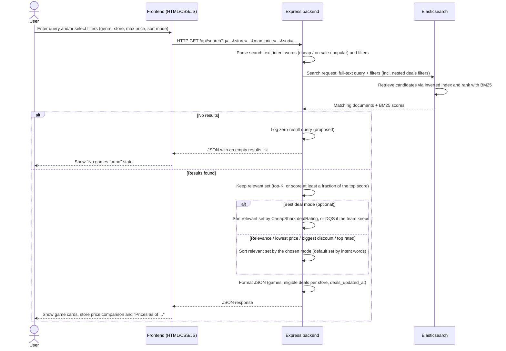

# System Design Diagrams

> **Status:** This is the planned design as of Meeting 3 (System Design). None of the components shown below is implemented yet. Items marked *optional* or *proposed* still need team agreement.

---

## 1. System Architecture Diagram

The system has two separate flows that share only the Elasticsearch index:

- **Ingestion / indexing (offline, Python):** builds and refreshes the index.
- **Runtime search:** answers user searches. Python does not run during a search.

```mermaid
flowchart LR
    subgraph ING["Ingestion / indexing (offline, Python)"]
        direction TB
        RAWG["RAWG API<br/>(game metadata)"]
        CS["CheapShark API<br/>(current deals and prices)"]
        STEAM["Steam reviews API<br/>(optional, excluded from MVP)"]
        FETCH["Fetch<br/>raw responses cached to disk"]
        PRE["Preprocessing + PC filtering<br/>(flatten, clean, convert types)"]
        MATCH["Entity matching / integration<br/>(canonical game_id)"]
        DOCS["Canonical game documents<br/>(one game = one document,<br/>nested deals array)"]
        REFRESH["Deal-refresh script<br/>(re-fetch deals by cheapshark_game_id)"]

        RAWG --> FETCH
        CS --> FETCH
        STEAM -.->|"optional, not in MVP"| FETCH
        FETCH --> PRE --> MATCH --> DOCS
        CS -->|"daily / before demos"| REFRESH
    end

    ES[("Elasticsearch index<br/>(inverted index, BM25)")]

    subgraph RT["Runtime search"]
        direction TB
        USER(["User"])
        FE["Frontend<br/>(HTML / CSS / JavaScript)"]
        BE["Express backend (Node.js)<br/>(query parsing, filters, sort mode)"]

        USER -->|"query + filters"| FE
        FE -->|"HTTP GET /api/search"| BE
        BE -->|"JSON results"| FE
        FE -->|"game cards + store price comparison"| USER
    end

    DOCS -->|"bulk index via Elasticsearch Python client<br/>(_id = game_id)"| ES
    REFRESH -->|"partial update via Elasticsearch Python client<br/>(deals, best_ fields, deals_updated_at)"| ES
    BE -->|"search request via Elasticsearch JavaScript client"| ES
    ES -->|"documents + BM25 scores"| BE
```

### Notes

- **Python and Express never talk to each other directly.** Python writes to the Elasticsearch index; Express only reads from it. There is no Python API and no "refresh" endpoint.
- **Steam reviews API (dashed): proposed for exclusion from the MVP**, because CheapShark deal data already includes Steam's rating percent, text, and count.
- **Deal refresh (proposed):** removes ended deals; a game with no current deals stays indexed with `deals: []`. Re-running the full pipeline overwrites documents by `game_id` instead of duplicating them.

---

## 2. Runtime Sequence Diagram

Example: a user searches `cheap RPG` or `Steam games on sale`.

### Notes

- **Relevant-set cut-off (proposed):** top-K (e.g. 30) or a relative threshold (e.g. at least 0.5 of the top score). The exact values are not decided.
- **Sort mode defaults (proposed):** "cheap" → lowest price, "on sale" → biggest discount (requires a discount > 0), "popular" → top rated (with a minimum `ratings_count`); otherwise relevance. The user can override this in the UI.
- **Best deal mode (optional):** CheapShark `dealRating`, or a DQS formula only if the team keeps DQS and evaluation shows it ranks better.
- **Missed-query log (proposed):** zero-result queries only, so the next pipeline run can look them up. Log format to be agreed with the backend.
